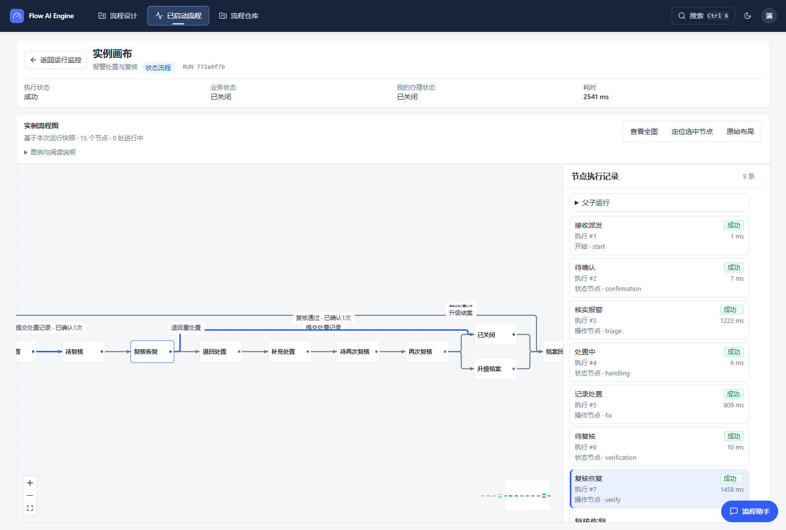
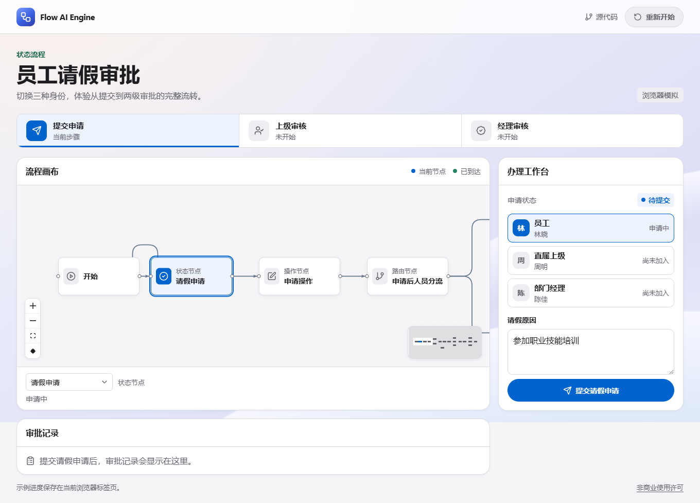

# Flow AI Engine

Flow AI Engine 是一个面向业务流程、自动化编排和数据处理的可视化平台。通过统一的流程画布、节点配置和运行工作台，连接人工审批、业务状态、系统调用与 AI 能力。

完整系统支持电脑网页端。[GitHub 发布包](https://github.com/Azurefly/flow-ai-engine/releases/latest) · [部署说明](docs/deployment-linux-docker.md) · [发布验收报告](docs/development/optimization/PRODUCT-RELEASE.md)

> **使用限制：仅限非商业用途。未经著作权人事先书面授权，不得用于商业开发、商业项目交付、收费服务或商业运营。修改代码、二次开发、重新打包或更换名称均不免除这一限制。** 完整条款见 [LICENSE](LICENSE)。

## 项目演示

### 设备报警处置主演示

这是一个使用合成设备报警的独立业务应用。控制流程按等级派发并等待固定版本的状态子流程结案。状态流程驱动确认、处置和复核。数据流程从已结案记录生成分组统计。三类流程均在 Flow AI Engine 中正式发布和执行。[演练源码（私有仓库）](https://github.com/Azurefly/alarm-response-demo)

**报警处置台与结案统计**


**引擎实例画布与节点执行记录**



#### 演练账号

下表是联测使用的三个角色。口令由演练项目管理员单独发放。复验时，可用独立浏览器配置文件保留三个角色的会话，也可退出后切换账号。上报时给标题添加演练标记，切换角色后按此标题选中同一条报警。

| 角色 | 用户名 | 演练职责 |
| --- | --- | --- |
| 值班员 | `alarm_56665ee2f481_duty` | 上报、核实报警或关闭误报 |
| 处置员 | `alarm_56665ee2f481_technician` | 提交现场处置记录或补充处置 |
| 复核员 | `alarm_56665ee2f481_reviewer` | 复核结案、发起补充处置和生成统计 |

#### 跑通紧急报警处置

1. **值班员**登录处置台，点「上报报警」→「填入温度越限样例」→「提交并派发」。选中新增报警，确认显示「紧急派发」和「待确认」。点击「确认属实」，等待状态进入「处置中」。
2. **处置员**登录并选中同一报警。在「记录处置」填写处理意见，例如“已完成散热检查，温度恢复正常”，再点「提交处置记录」。状态进入「待复核」。
3. **复核员**登录并选中同一报警。在「复核恢复」填写复核意见，点「复核通过」。确认报警显示「已关闭」，详情保留值班确认、处置和复核三条办理记录。
4. **复核员**点「生成统计」，等待显示「已生成」。结果表按报警等级和结案结果显示数量及平均耗时，可找到「高优先级 / 已关闭」分组。
5. 从报警详情点「控制实例」「状态实例」，从统计区点「数据实例」。可用演练账号登录引擎，查看各实例画布右侧的「节点执行记录」，并在数据实例查看「最终结果」。处置台和引擎控制台各自建立登录会话。

#### 复验其他分支

| 路径 | 操作及预期结果 |
| --- | --- |
| 常规误报关闭 | 值班员在「上报报警」选择「填入通信离线样例」并提交。核实为误报后填写处理意见，点「关闭误报」。流程在值班环节结束，业务状态为「误报关闭」。 |
| 退回补充后升级结案 | 值班员确认属实，处置员提交记录。复核员填写退回理由，点「退回重处置」。处置员完成「补充处置」，复核员在「再次复核」填写意见并点「升级结案」。业务状态为「升级结案」。 |

2026 年 11 月 21 日的桌面与接口联测覆盖了三条路径。截图中的统计包含 5 条演练记录，正常关闭 2 条、误报关闭 2 条、升级结案 1 条。[完整验收记录（私有仓库）](https://github.com/Azurefly/alarm-response-demo/blob/main/docs/acceptance.md)

### 请假审批辅助演示

1. 在「办理工作台」以员工身份填写请假原因，点击「提交请假申请」。
2. 点击「切换至直属上级」，再点击「通过并转交经理」。
3. 点击「切换至部门经理」，再点击「批准请假」，在「审批记录」中查看结果。

演示画布使用仓库中的请假流程定义。办理过程在浏览器中模拟，页面同步显示流程节点和参与人状态。进度保存在当前标签页，刷新后可继续。

[本机预览与发布辅助演示](#本机预览与发布演示) · [完整系统部署](docs/deployment-linux-docker.md)

#### 请假审批截图

**提交请假申请**



**两级审批完成**


## 三类流程

| 类型 | 运行方式 | 示例 |
| --- | --- | --- |
| 状态流程 | 由参与人的业务状态和所办操作推进，可分配办理人、撤回和重新提交。 | 员工提交请假，直属上级及部门经理依次审批。 |
| 控制流程 | 依照条件路由、并行分支、等待事件和人为审核调度动作。 | 两位经办人分别复核工单，双分支完成后汇聚一次。 |
| 数据流程 | 按依赖读取资产，逐步变换、校验、聚合并保存结果。 | 筛出已付款订单，按地区计数并汇总金额。 |

[三类流程使用说明与内置节点](docs/workflow-guide.md)

### 完整系统运行截图

**状态流程 · 请假审批的经理审核节点**


**控制流程 · 工单并行复核及汇聚**


**数据流程 · 订单筛选、质量校验及地区汇总结果**


## 主要功能

- **可视化配置**：三类流程共用保存、预检、运行与发布命令栏；桌面画布按可用空间调整，配置内容独立滚动。节点参数按业务分组，审批方式与结构化字段随面板空间排版。支持节点/连线定位、可撤销编排、全屏编辑及窄屏节点配置；运行仍需确认实际影响。
- **存量数据配置检查**：数据流程的“更多操作”可预览旧聚合字段和关联输入的转换建议。确认后仅修改当前填写，可撤销；有歧义时阻止转换。保存、审核、发布仍按正常流程进行，历史发布版本不会被自动改写，发布前需用样例核对计算结果。
- **数据排序规则**：同列混合类型按空值、数字、文本、布尔、数组、对象依次升序，降序反向；数字文本不隐式转成数字。纯数字按数值、纯文本按字典序比较，结构值按规范JSON比较；同值继续比较下一排序字段，全部相同则保留输入顺序。需跨类型按数值排序时，请先统一字段类型；非法非JSON值会明确报错。
- **数据连接器**支持内联样本、MySQL 只读查询、固定版本的分页 API 与 UTF-8 CSV。数据流可保存逐页检查点，发布版按冻结的资源版本读取。向支持回执的端点写回时，先预览，再由业务管理者确认并核对实际结果。[连接器配置与验收](docs/development/optimization/G01-IMPLEMENTATION.md)
- **持久父子流程**可绑定具体子流程发布版本。子流程等待人工或消息时，父实例保留等待状态。父子详情分别鉴权，任务完成后父流程继续。[父子运行与故障恢复](docs/development/optimization/G02-IMPLEMENTATION.md)
- **内部目录批量导入**支持账号、部门和成员关系。观察者可以查看自己上传的差异，管理员逐行确认、回读和回退。预览会标出冲突并保留已有人工修改。[文件模板与字段合同](docs/development/optimization/G03-IMPLEMENTATION.md)
- **流程助手**可根据业务描述准备状态、控制或数据流程。用户预览并确认后可打开已保存的设计草稿。助手还支持历史筛选、后台接单、刷新接续、取消排队和回执核对。管理员可查看队列及需人工核实的操作。[助手创建流程](docs/development/assistant-review.md#从助手创建流程) · [助手作业与运维](docs/development/optimization/G04-IMPLEMENTATION.md)
- **创建与复制**：创建窗口在当前账号会话内保留填写，关闭前确认，可导出未提交内容；创建结果未确认时使用原请求核对。复制保留同业务的目录及有效数据源，生成独立代号；来源变化后需重新确认。归档使用独立确认窗口，失败保留操作对象和提示，记录可从流程仓库恢复。
- **统一工作空间**：正文和控件 14px、辅助信息 13px、分区标题 16px、弹窗标题 18px、页面标题 20px；主要页面共享内容宽度、留白和可折叠导航，兼容窄屏、深色模式及系统减少动态效果设置。
- **数据运行控制**：手工与调度运行均先原子入队并返回实例，进度和结果由后台更新；状态/控制、数据流程和源测试的后台通道独立执行，每通道最多一个作业。服务器记录启动时实际核对的权限，发起人仍具该权限时可取消自己的排队或运行中数据实例，业务管理者可控制本业务实例；测试权限不会替代正式运行权限，历史记录沿用保守判断，保留已完成节点结果与取消原因；提交结果不确定时先核对原实例。当前外部查询可能要返回或超时后才能释放连接，不承诺立即终止远程查询；连接器等待默认60秒，可用 `DATA_CONNECTOR_TIMEOUT_MS` 在1至120秒内调整。取消与慢任务、权限竞争的真实环境验收仍需完成。
- **运行与任务管理**：运行记录、节点日志、审批待办、消息等待、暂停与恢复。
- **人员与权限管理**：账号、角色、组织及业务/流程授权；桌面目录与详情独立滚动，权限关系按需展开。支持有效期及按角色撤销，区分创建人与业务管理员，多项有效角色共同生效；失权后保留填写并隐藏已无权访问的内容。
- **系统角色授权**：用户与角色两个入口均支持有效期、备注、关闭确认和草稿恢复；绑定时校验所读角色配置，授权与审计在同一事务提交，失权或会话变化后拒绝写入。
- **组织配置保护**：部门、成员、主部门、迁移和部门权限组的变更与审计一并提交；等待后重新核对账号、登录状态和管理权限，避免报错后实际已变更。组织层级防循环，成员只保留一个主部门；添加或编辑前显示主部门变化，提交文案说明设置、切换或取消，成员菜单可避开表格边缘显示。桌面机构树与各类详情独立滚动，成员筛选、分页保持可见，长账号保留完整文本和末尾标识。 组织写入表单按需加载，填写与操作对象在当前账号会话内保留；配置冲突时可合并最新信息，保存确认后立即释放窗口，列表在后台更新。
- **账号创建保护**：单个与批量创建均逐账号提交账号及审计，失败回滚；并发死锁有界重试，提交期间锁定表单，失败后保留填写。
- **角色配置保护**：修改和删除校验读取时的配置快照；冲突时保留填写，支持导出草稿及确认后读取最新配置。常用权限组合可快速填写，未保存修改在关闭或离开前提示；角色的系统级/流程级范围与内置/自定义来源分别展示。
- **流程成员配置**：在同一入口管理内置协作角色与自定义角色，显示角色说明、有效期及历史记录，默认每页 10 条；两类填写分别保留，支持导出、关闭确认和撤销确认。授权修改与审计在同一事务中提交，等待后重新核对账号与管理权限；自定义流程角色绑定校验已确认的角色配置，变化后保留人员和有效期，重新确认后再提交。失权后可导出未提交填写，恢复权限后继续编辑。
- **工作台交互**：顶部工作空间与统一分类导航、`Ctrl/⌘ K` 快捷查找、权限来源定位及流程上下游高亮；主题即时切换，轻量反馈不阻挡导航，原生控件跟随主题，并尊重减少动态效果设置。
- **系统配置草稿**：通用设置和审批配置分别保留草稿，集中查看差异、导出、放弃和保存；离开或退出前确认。保存校验配置快照，配置与审计一起提交，刷新失败可单独重试。
- **资源填写恢复**：资源列表刷新失败时保留五类创建表单，可在弹窗中重新读取；切换资源类别保留填写，离开业务、退出或刷新前提示。列表不可用时暂停提交并隐藏过期列表。
- **业务异常恢复**：资源填写暂存在当前账号的内存会话中，业务页面因读取失败卸载后可重试恢复原填写和弹窗；恢复页支持导出填写，已确认的保存不会因页面重建而再次提交。
- **资源保存核对**：五类资源在响应中断后保留原请求，支持核对已提交结果，避免重试重复创建；核对时重新检查权限，资源、请求凭据与审计一起提交。
- **流程操作入口**：按具体流程的授权和发布状态展示设计、发起、执行、发布与审核入口；自定义流程角色与业务角色共同生效，独立复核时提示由其他管理员审核。发起表单支持关闭确认、提交锁定及失权后的填写恢复。
- **版本管理**：区分草稿测试与已发布流程，保留运行定义快照；取消发布后保留本地修改并衔接保存版本，响应中断可核对结果。发布入口按实际审批规则与权限显示。
- **流程审核复核**：审核窗口固定展示流程版本与审核状态；变更或冲突后需重新读取并复核。审核与审计原子提交，响应中断可核对原决定；发布事务重新检查最新审核结果和审批规则，按定义内容识别变化，避免数据库 JSON 字段顺序影响发布。
- **私有子流程快照**：保存父流程草稿时捕获引用定义；审核、预检和发布使用该快照。个人库更新后可显式更新快照并保存，变化后按审批规则重新复核，已发布版本和历史运行保持原定义。
- **编辑冲突保护**：保存与发布校验编辑版本；冲突时保留当前修改，支持导出后读取最新版本。
- **流程访问恢复**：设计器、详情与运行监控定时复核查看权限；失权或权限读取失败时隐藏缓存内容。同一账号的未保存配置和运行操作原因保留，恢复授权后可重试继续；外部版本变化仍须先处理冲突。
- **流程提交与版本恢复**：创建、导入和复制一次提交完整定义、初始版本、所有者关系与审计；保存、发布、归档及恢复会在事务内重新核对账号、权限和流程版本，失败一并回滚。历史版本默认恢复为草稿，可显式选择恢复发布状态，仍需满足当前发布权限和审批规则。
- **业务授权保护**：成员和部门授权在事务内复核管理权限，授权与审计同时提交；提交期间锁定填写，失败、失权或业务页恢复时保留当前账号的草稿。列表读取失败时隐藏过期记录，恢复后可核对再保存。
- **节点数值配置**：小数及未完成输入即时同步到草稿，支持范围提示和键盘调整；非法数值阻止保存，快捷键保存无需先移出输入框。
- **可选参数说明**：数值留空时直接显示实际默认行为；数据流程的输出行数限制留空后保留全部输入行，读取上限与模型参数分别给出对应提示。
- **流程基本信息**：名称与说明按读取时的配置确认，权限复核、修改与审计同事务提交；冲突保留填写，读取最新信息后可显式确认继续。保存响应不确定时先核对结果，避免重复修改与审计；支持当前账号会话内暂存和关闭确认。
- **实例流程图**：面向电脑端按运行快照展示节点、连线及执行批次；普通入口默认全图，任务和操作记录入口保留精确定位。数据实例可切换画布和最终结果，保留节点、缩放、平移与分页，结果表默认每页10行，长字段名限宽显示，单元格可打开完整内容；资源样本和运行字段按原字号换行、独立滚动，保留换行、空值与布尔值。
- **业务签署结果**：自定义办理代号可指定通过、拒绝或弃权含义，多人签署按原门槛汇总到唯一业务出口；配置歧义提前提示，自动执行仅走唯一通过分支。
- **任务工作台**：分页只返回办理摘要，打开详情后再读取完整表单和执行上下文；任务接口支持按运行筛选，保留既有完整列表调用方式。
- **三级流程验收**：可通过 `scripts/three-level-flow-acceptance.cjs` 读取两份外部流程XML，构造省厅、市局、分局三级隔离场景，覆盖共享任务任一人签收办理、会签、或签、退回补正和跨级权限；输入文档及运行材料仅留本地。该脚本采用固定三级展开，不代表通用递归子流程导入。增加 `--business-outcomes` 可验证自定义业务代号、顺序会签和自动执行。适配约定：53为下级处置反馈完成，88为同级警种协同完成；业务命令保留原名称与溯源，签署结果映射为通过或拒绝。
- **业务治理与循环**：支持业务归档、历史查看和按需恢复；状态与控制流程支持有界返回、人工重办及等待后的迭代恢复。
- **AI 与接口集成**：提供 HTTP 调用和兼容 OpenAI API 的模型配置能力。
- **数据流定时计划**：内置 UTC 调度、常用周期快捷填写、下一次执行时间及启停管理；保存为暂停草稿，修改和删除受版本冲突保护。

## 本机预览与发布演示

以下命令用于请假审批辅助演示。报警处置主演示的本机集成步骤见[演练仓库说明](https://github.com/Azurefly/alarm-response-demo#本地启动)。

### 本机预览

使用 Node.js 22 和 `package.json` 指定的 pnpm 版本，在仓库根目录的 PowerShell 中执行以下命令。

```powershell
pnpm install --frozen-lockfile
pnpm demo:build
pnpm demo:preview
```

打开终端显示的本地地址。演示的静态产物位于 `dist/demo`，包含项目许可。

### 发布到 GitHub Pages

首次配置时，将仓库 **Settings → Pages → Source** 设为 **GitHub Actions**。之后从 **Actions** 手动运行「发布请假审批演示」，部署环境会显示站点地址。[发布工作流](.github/workflows/demo-pages.yml)

## 模型服务配置

登录后从右下角打开助手，选择 **业务工作台助手**。例如，在项目内输入“按审核状态统计这个项目的流程”，在流程详情输入“统计最近一周的运行次数和失败率”，或要求“生成财务与法务并行审批、双方结束后汇合的流程”。生成的画布可以预览、修改要求，再确认保存为可编辑草稿。任务领取、审批、移交、流程发布、启动、调度等业务操作会先展示确认单，按登录账号权限执行。

管理员从 **系统配置 → AI 助手配置** 或助手右上角的「管理 Agent」进入配置页（`#/system/agents`）。列表和编辑器显示草稿与已发布版本，可查看差异、选择模型和工具、限定角色与项目。保存后可试聊，试聊确认只模拟业务写入。发布后新对话使用新配置。升级会保留现有助手和管理员的草稿。模型服务须支持工具调用。

管理员进入 **系统配置 → 模型服务**，填写兼容 OpenAI API 的完整基础地址、默认模型 ID 和 **API Key**。Key 使用密码框输入；留空保留现有 Key，保存后仅显示配置状态，不回传明文。保存后分别使用“读取模型”和“测试调用”检查接入，后者会发送固定问候并可能产生少量费用。Gemini 可使用 `/v1beta/openai` 前缀；地址不要带 `/chat/completions` 或 `/models`。节点显式选择的模型优先于默认模型。

服务端采用 AES-256-GCM 加密保存 Key，普通读取、草稿导出和审计均不包含 Key 或加密内容。部署脚本在服务器密钥目录中一次性生成 `.llm-master-key`（32字节，root:1000、0440），已存在时绝不覆盖；应用只读挂载该目录。**数据库恢复时必须保留对应主密钥，请单独安全备份该文件，不要提交到 Git，也不要重新生成或随意更换。** API Key 的更新、清除与设置、审计原子提交，并校验所读配置，避免其他管理员的更新被覆盖。

需要沿用运维托管凭据时，展开“高级配置”，填写 `env:FLOW_SECRET_GEMINI_API_KEY` 等服务器引用。对应服务器同名环境变量或 `FLOW_SECRET_FILE_DIR` 目录中的同名普通文件；引用优先于网页已保存的 Key，填写新 Key 会清空引用。没有网页 Key 和引用时沿用 `OPENAI_API_KEY`（兼容旧 `BUILT_IN_FORGE_API_KEY`）；地址留空时沿用 `OPENAI_BASE_URL`（兼容旧 `BUILT_IN_FORGE_API_URL`）。当前 HTTP 测试环境不提供传输加密，正式环境须使用 HTTPS。连接成功仍需单独验证真实流程输出和分支。

## 技术栈

- 前端：React 19、TypeScript、Vite、Tailwind CSS、React Flow、Radix UI。
- 后端：Node.js、Express、tRPC、Drizzle ORM、MySQL 8.4。
- 工程：pnpm、Vitest、Docker Compose。

## 项目结构

```text
client/     前端页面与组件
server/     服务接口、权限控制与流程执行
shared/     前后端共享的类型与流程契约
drizzle/    数据库结构与迁移
scripts/    构建、部署与功能验收脚本
```

## 开发与评审入口

[开发索引](docs/development/INDEX.md)按业务操作列出页面、服务、数据库与用例。[协作约定](Agent.md)说明如何接手任务。[功能与需求评审](docs/development/review-baseline.md)记录 2026-11-19 的实测结论，并关联整改、助手与 UI 动效设计。

接手优化时从[开发智能体任务入口](docs/development/optimization/START-HERE.md)领取具体编号，按[验收场景](docs/development/optimization/ACCEPTANCE.md)核对业务终态。仓库收录[完整审计报告](docs/development/optimization/REPORT.md)。

## 路由验收脚本

`scripts/router-label-acceptance.mjs` 会创建业务项目、审核并发布四个流程、启动真实运行，验证旧路由名称及优先级、广播、默认分支。**它不是只读检查，应仅在专用验收环境运行。**

运行前通过环境变量设置 `FLOW_ACCEPTANCE_BASE_URL`，并将 `FLOW_ACCEPTANCE_CONFIRM_WRITES` 设为该地址的精确 origin（协议、主机和端口，不含末尾斜杠），另需已有账号的 `FLOW_BOOTSTRAP_ADMIN_USERNAME` / `FLOW_BOOTSTRAP_ADMIN_PASSWORD`。脚本没有默认服务器地址；远程目标必须使用 HTTPS，只有 loopback 地址允许 HTTP（可通过 SSH 隧道连接测试环境）。确认变量只确认写入范围，不替代服务端权限检查。

脚本不跟随重定向，单个请求限时 15 秒，不自动重试写入，不打印凭据。运行前输出唯一业务代号，创建成功后逐步输出业务、流程和运行 ID；产物会保留供检查，**不会自动清理**。失败或响应不确定时先按该代号/ID 核对数据，再由操作人仅清理本轮产物，避免重跑造成重复数据。

## 当前状态

支持状态、控制、数据三类流程，以及内部目录和权限管理、已启动流程和后台助手。数据连接器、固定发布版本的父子流程、内部目录批量导入及助手作业，都有相应的使用与验收说明。接入生产数据源、模型和 OAuth 时，按各自部署配置核对权限、容量及外部回执。[受支持的发布范围与环境依赖](docs/development/optimization/PRODUCT-RELEASE.md)

## 许可与使用范围

本仓库当前版本采用自定义的**非商业使用许可**，提供源码供个人学习、非商业研究、非商业教学及功能评估使用。公开源码不代表允许商业使用；具体授权范围以 [LICENSE](LICENSE) 为准。

未经著作权人事先书面授权，禁止将本项目或基于本项目的二次开发版本用于：

- 开发、集成、销售或交付商业软件、商业平台、插件、SDK 或其他商业产品，包括作为商业产品的一部分。
- 提供收费的 SaaS、PaaS、API、云托管或其他在线服务，以及通过订阅、广告、佣金等方式获利的服务。
- 承接商业定制、外包、项目交付，或以本项目为服务内容提供收费部署、运维、咨询或培训。
- 企业内部以经营、生产、管理或其他商业利益为目的的实际使用；非商业学习和短期功能评估仍应遵守许可条件。
- 将源码、安装包、镜像或二次开发版本出售、转售、付费分发，或通过更换名称、界面、商标等方式规避限制。

在许可范围内分享或修改时，必须保留原有版权声明、完整许可文本和本项目出处，并明确标注修改；不得向他人授予本许可未授予的商业权利。申请商业使用前，请通过本仓库的维护者联系方式或 GitHub Issue 说明使用场景，并取得著作权人的明确书面授权；未获明确授权不得开展商业使用。

第三方依赖、引用代码和素材仍按各自许可证使用。本次说明适用于受本许可覆盖的当前及后续版本，不自动改变此前明确依据其他许可证发布版本的授权条件。

## 仓库文件约定

仓库保留应用源码、测试源码、依赖锁文件、数据库迁移和维护文档。测试报告、临时截图、日志、缓存及历史验证材料仅保留在本地；新增临时验收产物统一放入已忽略的 `.cache/`，不提交到 GitHub。

浏览器测试生成的登录状态、录像、追踪文件，以及本地备份也不提交。清理已跟踪的本地产物时使用 `git rm --cached`，保留磁盘上的文件；测试用例和迁移快照属于源码，应继续提交。

历史实施方案、一次性建测试账号或操作现有调度的辅助脚本仅留本地。长期维护的部署说明、节点契约、回归清单和可复用验收脚本继续纳入版本控制。本次清理只调整当前分支的文件跟踪，既有提交历史保留。

数据库结构以 `drizzle/schema.ts` 和 `drizzle/` 下的版本迁移为准；旧测试目录中的 SQL 汇总和初始化脚本仅留本地，不作为建库入口。各级测试目录的 `reports/`、`test-output/`、`test-outputs/`、`test-artifacts/`，以及 JUnit 报告、测试结果 JSON、追踪压缩包和补丁中间文件也应留在本地。

测试工具的 `.auth/` 登录状态、`.last-run.json`、Python 覆盖率文件与 `htmlcov/` 报告、`.tox/` 和 `.nox/` 测试环境同样仅留本地，并排除在 Docker 构建上下文之外。清理仓库时保留可复用测试脚本、测试用例、依赖锁文件和数据库迁移快照。
