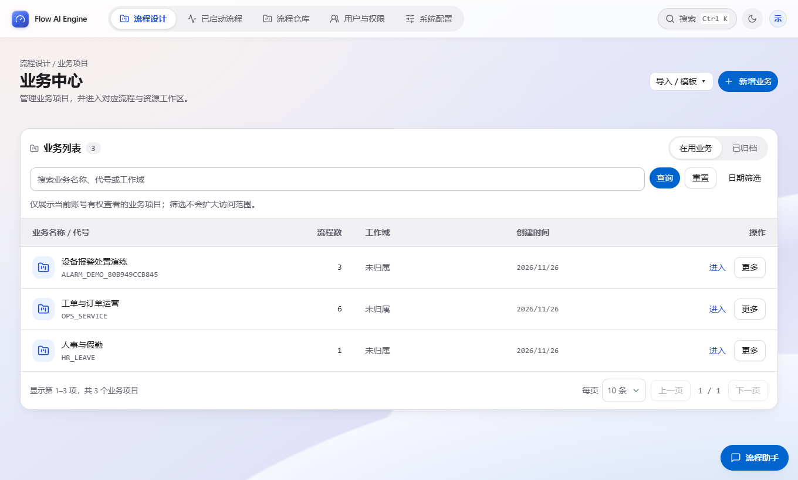
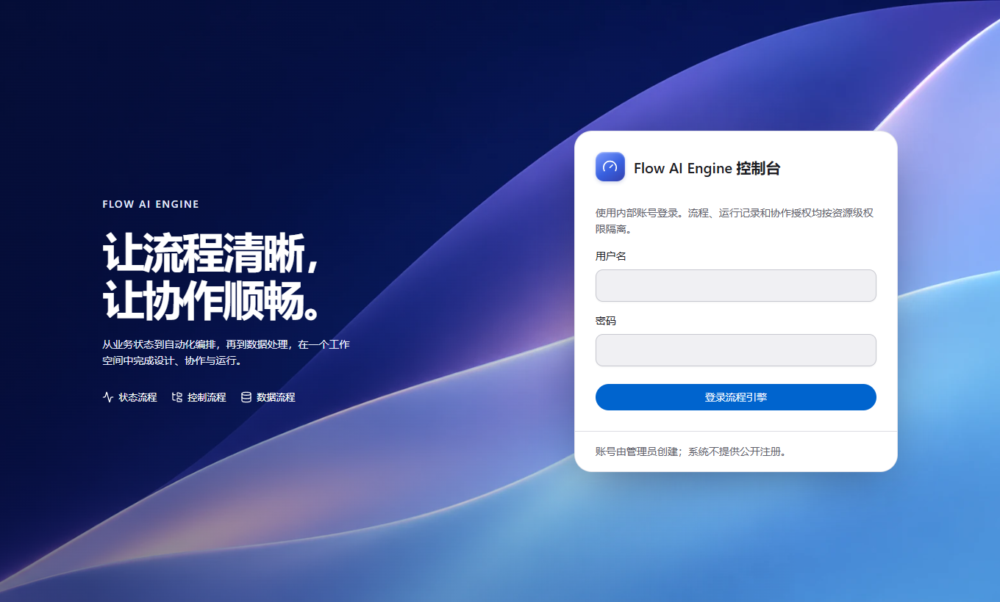
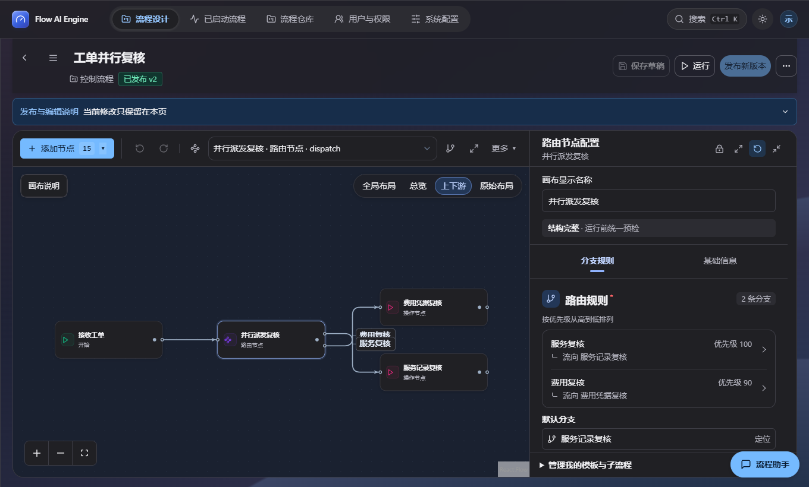
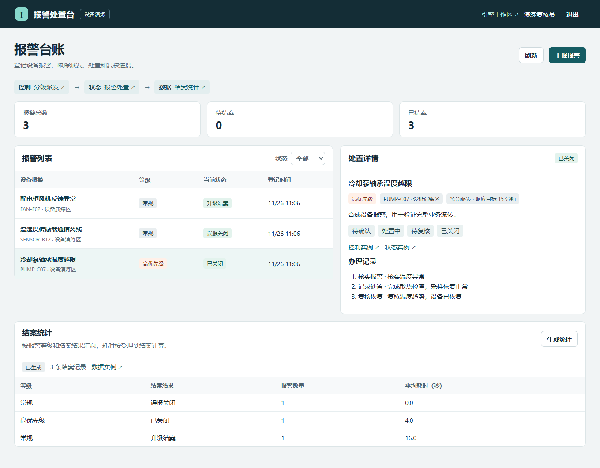
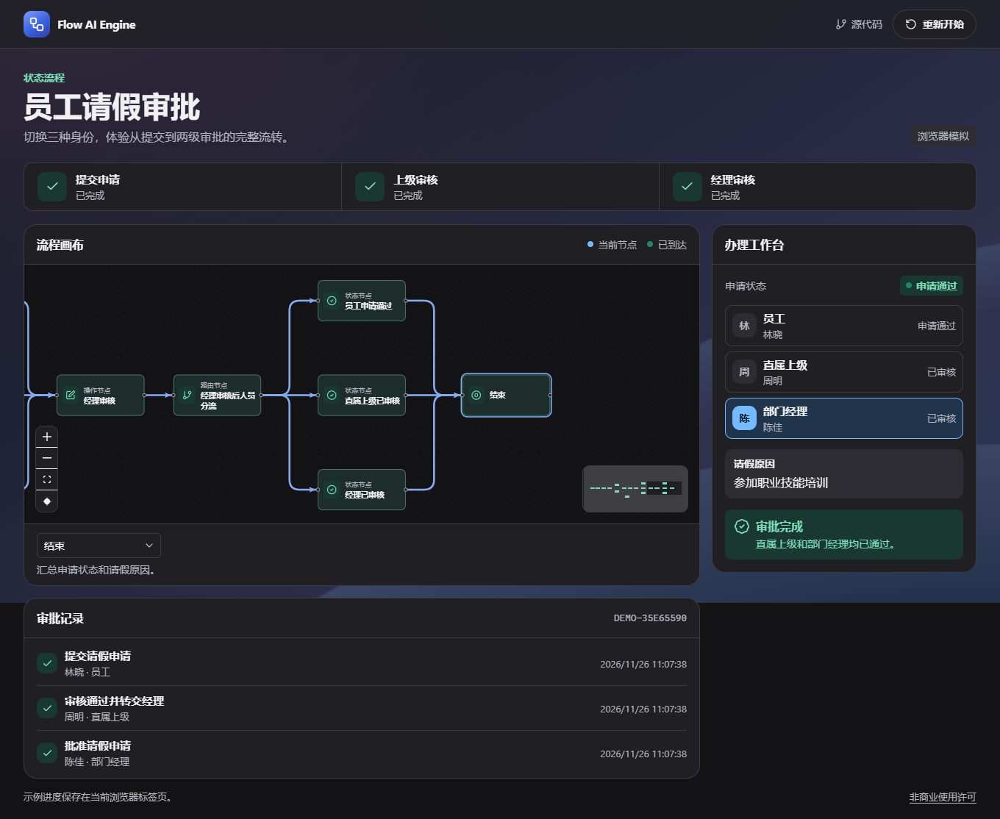
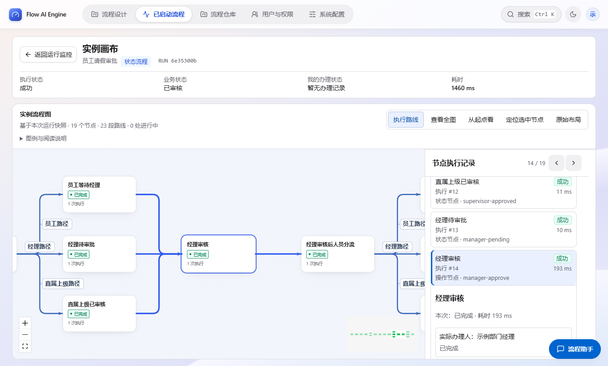
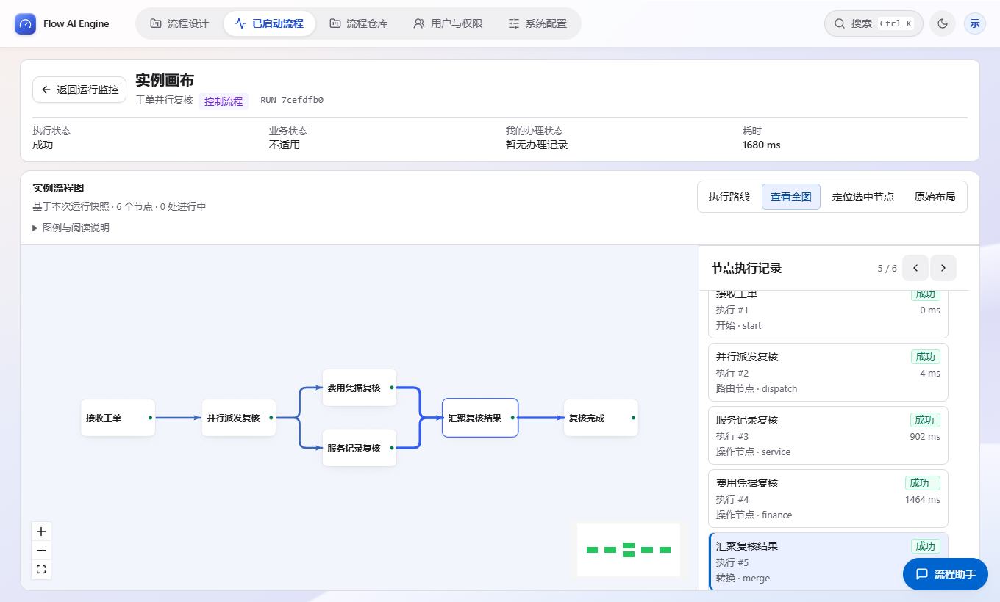
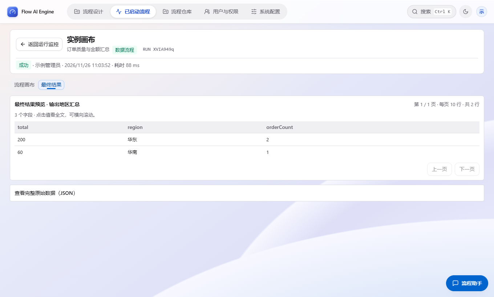

# Flow AI Engine

Flow AI Engine 是一个面向业务流程、自动化编排和数据处理的可视化平台。通过统一的流程画布、节点配置和运行工作台，连接人工审批、业务状态、系统调用与 AI 能力。

完整系统可在电脑浏览器中使用。[控制台界面](#控制台界面) · [项目演示](#项目演示) · [GitHub 发布包](https://github.com/Azurefly/flow-ai-engine/releases/latest) · [部署说明](docs/deployment-linux-docker.md) · [发布验收报告](docs/development/optimization/PRODUCT-RELEASE.md)

> **使用限制：仅限非商业用途。未经著作权人事先书面授权，不得用于商业开发、商业项目交付、收费服务或商业运营。修改代码、二次开发、重新打包或更换名称均不免除这一限制。** 完整条款见 [LICENSE](LICENSE)。

## 控制台界面

登录后，从「流程设计」进入业务中心。按业务名称或代号查找项目，点击对应行的「进入」。下图中的设备报警、工单和请假是三个独立的示例业务。



| 要做的事 | 从哪里进入 |
| --- | --- |
| 设计或修改流程 | 在业务内打开「流程设计中心」，选择流程并进入设计器。选中节点后，右侧可编辑参数，「上下游」可聚焦相连节点。 |
| 配置数据资源 | 在同一业务的「资源配置中心」管理数据源和资源目录。切到「数据流」可查看运行记录和调度。 |
| 办理待办或追踪结果 | 打开顶部「已启动流程」。在「流程工作台」办理分派给自己的任务，在「运行监控」选择实例，查看执行路线、节点记录或数据结果。 |

<details>
<summary>查看登录页和深色流程设计器</summary>

登录页使用蓝紫色曲面背景。输入账号和密码，点击「登录流程引擎」即可进入控制台。



从控制台右上角可切换明暗主题。下图在深色设计器中选中了「并行派发复核」，画布显示接收工单后分出的两条复核路径，右侧列出各自的路由规则和优先级。



</details>

## 项目演示

### 设备报警处置主演示

这是一个使用合成设备报警的独立业务应用。控制流程按等级派发并等待固定版本的状态子流程结案。状态流程驱动确认、处置和复核。数据流程从已结案记录生成分组统计。三类流程均在 Flow AI Engine 中正式发布和执行。[演练源码](https://github.com/Azurefly/alarm-response-demo) · [对接 Flow AI Engine](https://github.com/Azurefly/alarm-response-demo/blob/main/docs/flow-engine-integration.md)

在报警处置台选择一条报警，可同时查看派发方式、办理记录和结案状态。下图的三条合成报警分别以正常关闭、误报关闭和升级结案结束，底部统计各有一条。



从报警详情打开「状态实例」。在引擎画布右侧选中「复核恢复」记录，即可看到这条报警进入「已关闭」的过程。


#### 演练账号

下表是联测使用的三个角色，口令由演练项目管理员单独发放。自行部署时，使用本次初始化生成的账号。复验时，可用独立浏览器配置文件保留三个角色的会话，也可退出后切换账号。上报时给标题添加演练标记，切换角色后按此标题选中同一条报警。

| 角色 | 用户名 | 演练职责 |
| --- | --- | --- |
| 值班员 | `alarm_56665ee2f481_duty` | 上报、核实报警或关闭误报 |
| 处置员 | `alarm_56665ee2f481_technician` | 提交现场处置记录或补充处置 |
| 复核员 | `alarm_56665ee2f481_reviewer` | 复核结案、发起补充处置和生成统计 |

#### 跑通紧急报警处置

1. **值班员**登录处置台，点「上报报警」→「填入温度越限样例」→「提交并派发」。选中新增报警，确认显示「紧急派发」和「待确认」。点击「确认属实」，等待状态进入「处置中」。
2. **处置员**登录并选中同一报警。在「记录处置」填写处理意见，例如“已完成散热检查，温度恢复正常”，再点「提交处置记录」。状态进入「待复核」。
3. **复核员**登录并选中同一报警。在「复核恢复」填写复核意见，点「复核通过」。确认报警显示「已关闭」，详情保留值班确认、处置和复核三条办理记录。
4. **复核员**点「生成统计」，等待显示「已生成」。结果表按报警等级和结案结果显示数量及平均耗时，可找到「高优先级 / 已关闭」分组。
5. 从报警详情点「控制实例」「状态实例」，从统计区点「数据实例」。可用演练账号登录引擎，查看各实例画布右侧的「节点执行记录」，并在数据实例查看「最终结果」。处置台和引擎控制台各自建立登录会话。

#### 复验其他分支

| 路径 | 操作及预期结果 |
| --- | --- |
| 常规误报关闭 | 值班员在「上报报警」选择「填入通信离线样例」并提交。核实为误报后填写处理意见，点「关闭误报」。流程在值班环节结束，业务状态为「误报关闭」。 |
| 退回补充后升级结案 | 值班员确认属实，处置员提交记录。复核员填写退回理由，点「退回重处置」。处置员完成「补充处置」，复核员在「再次复核」填写意见并点「升级结案」。业务状态为「升级结案」。 |

2026 年 11 月 21 日的桌面与接口联测另有逐步操作和回执记录，覆盖上述三条路径。[完整验收记录](https://github.com/Azurefly/alarm-response-demo/blob/main/docs/acceptance.md)

### 请假审批辅助演示

1. 在「办理工作台」以员工身份填写请假原因，点击「提交请假申请」。
2. 点击「切换至直属上级」，再点击「通过并转交经理」。
3. 点击「切换至部门经理」，再点击「批准请假」，在「审批记录」中查看结果。

演示画布使用仓库中的请假流程定义。办理过程在浏览器中模拟，页面同步显示流程节点和参与人状态。进度保存在当前标签页，刷新后可继续。

[本机预览与发布辅助演示](#本机预览与发布演示) · [完整系统部署](docs/deployment-linux-docker.md)

#### 请假审批截图

员工准备提交时，左侧画布高亮当前节点，右侧「办理工作台」显示当前身份、请假原因和提交按钮。


部门经理批准后，三个阶段全部完成。「审批记录」保留员工提交、直属上级转交和部门经理批准的结果，下图为深色模式。



## 三类流程

| 类型 | 运行方式 | 示例 |
| --- | --- | --- |
| 状态流程 | 由参与人的业务状态和所办操作推进，可分配办理人、撤回和重新提交。 | 员工提交请假，直属上级及部门经理依次审批。 |
| 控制流程 | 依照条件路由、并行分支、等待事件和人为审核调度动作。 | 两位经办人分别复核工单，双分支完成后汇聚一次。 |
| 数据流程 | 按依赖读取资产，逐步变换、校验、聚合并保存结果。 | 筛出已付款订单，按地区计数并汇总金额。 |

[三类流程使用说明与内置节点](docs/workflow-guide.md)

### 完整系统运行截图

**状态流程**　选择「经理审核」执行记录，画布定位到该节点。右侧显示实际办理人为「示例部门经理」，任务状态为「已完成」。



**控制流程**　切到「查看全图」，可以沿连线看到同一张工单如何分到费用、服务两个复核节点，再汇聚到一个出口。



**数据流程**　在订单汇总实例中打开「最终结果」，可直接核对地区、订单数与合计金额。这四笔样例订单筛选后，华东有 2 单、合计 200 元，华南有 1 单、合计 60 元。



## 主要功能

[查看完整功能清单](docs/features.md)

## 本机预览与发布演示

以下命令用于请假审批辅助演示。报警处置主演示的本机集成步骤见[演练仓库说明](https://github.com/Azurefly/alarm-response-demo#本地启动)。

### 本机预览

使用 Node.js 22 和 `package.json` 指定的 pnpm 版本，在仓库根目录的 PowerShell 中执行以下命令。

```powershell
pnpm install --frozen-lockfile
pnpm demo:build
pnpm demo:preview
```

打开终端显示的本地地址。演示的静态产物位于 `dist/demo`，包含项目许可。

### 发布到 GitHub Pages

首次配置时，将仓库 **Settings → Pages → Source** 设为 **GitHub Actions**。之后从 **Actions** 手动运行「发布请假审批演示」，部署环境会显示站点地址。[发布工作流](.github/workflows/demo-pages.yml)

## 模型服务配置

登录后点击右下角的「流程助手」，即可向管理员设置的默认助手提问。例如，在项目内输入“按审核状态统计这个项目的流程”，在流程详情输入“统计最近一周的运行次数和失败率”，或要求“生成财务与法务并行审批、双方结束后汇合的流程”。生成的画布可以预览、修改要求，再确认保存为可编辑草稿。任务领取、审批、移交、流程发布、启动、调度等业务操作会先展示确认单，按登录账号权限执行。

管理员从 **系统配置 → AI 助手配置** 或助手右上角的「管理 Agent」进入配置页（`#/system/agents`）。列表和编辑器显示草稿与已发布版本，可查看差异、选择模型和工具、限定角色与项目。保存后可试聊，试聊确认只模拟业务写入。发布后新对话使用新配置。升级会保留现有助手和管理员的草稿。模型服务须支持工具调用。

管理员进入 **系统配置 → 模型服务**，填写兼容 OpenAI API 的完整基础地址、默认模型 ID 和 **API Key**。Key 使用密码框输入；留空保留现有 Key，保存后仅显示配置状态，不回传明文。保存后分别使用“读取模型”和“测试调用”检查接入，后者会发送固定问候并可能产生少量费用。Gemini 可使用 `/v1beta/openai` 前缀；地址不要带 `/chat/completions` 或 `/models`。节点显式选择的模型优先于默认模型。

服务端采用 AES-256-GCM 加密保存 Key，普通读取、草稿导出和审计均不包含 Key 或加密内容。部署脚本在服务器密钥目录中一次性生成 `.llm-master-key`（32字节，root:1000、0440），已存在时绝不覆盖；应用只读挂载该目录。**数据库恢复时必须保留对应主密钥，请单独安全备份该文件，不要提交到 Git，也不要重新生成或随意更换。** API Key 的更新、清除与设置、审计原子提交，并校验所读配置，避免其他管理员的更新被覆盖。

需要沿用运维托管凭据时，展开“高级配置”，填写 `env:FLOW_SECRET_GEMINI_API_KEY` 等服务器引用。对应服务器同名环境变量或 `FLOW_SECRET_FILE_DIR` 目录中的同名普通文件。引用优先于网页已保存的 Key，填写新 Key 会清空引用。没有网页 Key 和引用时沿用 `OPENAI_API_KEY`（兼容旧 `BUILT_IN_FORGE_API_KEY`）。地址留空时沿用 `OPENAI_BASE_URL`（兼容旧 `BUILT_IN_FORGE_API_URL`）。正式部署请通过 HTTPS 配置模型凭据。连接成功后，用实际流程验证输出和分支。

## 技术栈

- 前端：React 19、TypeScript、Vite、Tailwind CSS、React Flow、Radix UI。
- 后端：Node.js、Express、tRPC、Drizzle ORM、MySQL 8.4。
- 工程：pnpm、Vitest、Docker Compose。

## 项目结构

```text
client/     前端页面与组件
server/     服务接口、权限控制与流程执行
shared/     前后端共享的类型与流程契约
drizzle/    数据库结构与迁移
scripts/    构建、部署与功能验收脚本
```

## 开发与评审入口

[开发索引](docs/development/INDEX.md)按业务操作列出页面、服务、数据库与用例。[协作约定](Agent.md)说明如何接手任务。[功能与需求评审](docs/development/review-baseline.md)记录 2026-11-19 的实测结论，并关联整改、助手与 UI 动效设计。

接手优化时从[开发智能体任务入口](docs/development/optimization/START-HERE.md)领取具体编号，按[验收场景](docs/development/optimization/ACCEPTANCE.md)核对业务终态。仓库收录[完整审计报告](docs/development/optimization/REPORT.md)。

## 路由验收脚本

`scripts/router-label-acceptance.mjs` 会创建业务项目、审核并发布四个流程、启动真实运行，验证旧路由名称及优先级、广播、默认分支。**它不是只读检查，应仅在专用验收环境运行。**

运行前通过环境变量设置 `FLOW_ACCEPTANCE_BASE_URL`，并将 `FLOW_ACCEPTANCE_CONFIRM_WRITES` 设为该地址的精确 origin（协议、主机和端口，不含末尾斜杠），另需已有账号的 `FLOW_BOOTSTRAP_ADMIN_USERNAME` / `FLOW_BOOTSTRAP_ADMIN_PASSWORD`。脚本没有默认服务器地址；远程目标必须使用 HTTPS，只有 loopback 地址允许 HTTP（可通过 SSH 隧道连接测试环境）。确认变量只确认写入范围，不替代服务端权限检查。

脚本不跟随重定向，单个请求限时 15 秒，不自动重试写入，不打印凭据。运行前输出唯一业务代号，创建成功后逐步输出业务、流程和运行 ID；产物会保留供检查，**不会自动清理**。失败或响应不确定时先按该代号/ID 核对数据，再由操作人仅清理本轮产物，避免重跑造成重复数据。

## 当前状态

支持状态、控制、数据三类流程，以及内部目录和权限管理、已启动流程和后台助手。数据连接器、固定发布版本的父子流程、内部目录批量导入及助手作业，都有相应的使用与验收说明。接入生产数据源、模型和 OAuth 时，按各自部署配置核对权限、容量及外部回执。[受支持的发布范围与环境依赖](docs/development/optimization/PRODUCT-RELEASE.md)

## 许可与使用范围

本仓库当前版本采用自定义的**非商业使用许可**，提供源码供个人学习、非商业研究、非商业教学及功能评估使用。公开源码不代表允许商业使用；具体授权范围以 [LICENSE](LICENSE) 为准。

未经著作权人事先书面授权，禁止将本项目或基于本项目的二次开发版本用于：

- 开发、集成、销售或交付商业软件、商业平台、插件、SDK 或其他商业产品，包括作为商业产品的一部分。
- 提供收费的 SaaS、PaaS、API、云托管或其他在线服务，以及通过订阅、广告、佣金等方式获利的服务。
- 承接商业定制、外包、项目交付，或以本项目为服务内容提供收费部署、运维、咨询或培训。
- 企业内部以经营、生产、管理或其他商业利益为目的的实际使用；非商业学习和短期功能评估仍应遵守许可条件。
- 将源码、安装包、镜像或二次开发版本出售、转售、付费分发，或通过更换名称、界面、商标等方式规避限制。

在许可范围内分享或修改时，必须保留原有版权声明、完整许可文本和本项目出处，并明确标注修改；不得向他人授予本许可未授予的商业权利。申请商业使用前，请通过本仓库的维护者联系方式或 GitHub Issue 说明使用场景，并取得著作权人的明确书面授权；未获明确授权不得开展商业使用。

第三方依赖、引用代码和素材仍按各自许可证使用。本次说明适用于受本许可覆盖的当前及后续版本，不自动改变此前明确依据其他许可证发布版本的授权条件。

## 仓库文件约定

仓库保留应用源码、测试源码、依赖锁文件、数据库迁移和维护文档。测试报告、临时截图、日志、缓存及历史验证材料仅保留在本地；新增临时验收产物统一放入已忽略的 `.cache/`，不提交到 GitHub。

浏览器测试生成的登录状态、录像、追踪文件，以及本地备份也不提交。清理已跟踪的本地产物时使用 `git rm --cached`，保留磁盘上的文件；测试用例和迁移快照属于源码，应继续提交。

历史实施方案、一次性建测试账号或操作现有调度的辅助脚本仅留本地。长期维护的部署说明、节点契约、回归清单和可复用验收脚本继续纳入版本控制。本次清理只调整当前分支的文件跟踪，既有提交历史保留。

数据库结构以 `drizzle/schema.ts` 和 `drizzle/` 下的版本迁移为准；旧测试目录中的 SQL 汇总和初始化脚本仅留本地，不作为建库入口。各级测试目录的 `reports/`、`test-output/`、`test-outputs/`、`test-artifacts/`，以及 JUnit 报告、测试结果 JSON、追踪压缩包和补丁中间文件也应留在本地。

测试工具的 `.auth/` 登录状态、`.last-run.json`、Python 覆盖率文件与 `htmlcov/` 报告、`.tox/` 和 `.nox/` 测试环境同样仅留本地，并排除在 Docker 构建上下文之外。清理仓库时保留可复用测试脚本、测试用例、依赖锁文件和数据库迁移快照。
