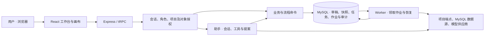

# 当前系统设计

本页描述流程定义、审批、运行和工作台的调用路径。迁移 0049 加入固定版本的连接器、持久父子调用、内部目录批次和助手后台作业。各模块的接口、表结构、权限和恢复规则可从[开发索引](INDEX.md)进入，审计时点的设计取舍见[整改设计](remediation-design.md)。

## 从定义到运行

| 阶段 | 核心对象 | 设计要点 |
| --- | --- | --- |
| 组织资源 | 账号、有效角色及部门、工作域、业务项目、目录 | 用户是否可见、能否编辑和能否正式运行分别判断。直接角色与部门来源可能同时有效。撤销一种来源后需重算有效权限。 |
| 定义 | 草稿、节点与连线、定义修订、引用子流程快照 | 画布持有本地编辑态。保存以用户所读版本为前提。三类流程复用定义外形，允许的节点和编译约束分开定义。 |
| 发布 | 审核决定、发布版本、版本历史、审批规则 | 准入检查关注当前权限、版本、资源状态。恢复发布版本也检查当前规则。历史实例通过本次快照解释。 |
| 执行 | 运行和节点运行、执行计划、持久作业、租约与检查点 | 接单、实际执行、终态和作业收尾可能发生在不同事务。读取正确的对象、关联 ID 与阶段，才能判断是否完成。 |
| 人工与数据 | 待办、人员卡片、签署组、等待订阅。数据作业、产物、血缘 | 办理按当前轮次和资格推进。数据流的 MySQL 只读、质量门槛、取消和调度各有单独证据，失败节点保留诊断。 |
| 审计 | 业务变更日志、实例历史、工具回执 | 界面提示须能追溯至服务端读取。不同领域的请求重放能力早于或晚于其他领域上线，新增入口需核对实际合同。 |

## 三类流程与助手

- **状态流程**把人员当前状态、可执行操作、路由与下一轮待办联系起来。撤回、换人、重提依赖执行轮次，旧的任务卡片应失效。[参与人设计](../participant-state-routing-design.md)
- **控制流程**运行条件、并行、循环、人工、消息、HTTP 和模型节点。并行广播显式绑定汇聚节点。私有同步子流程沿用捕获的快照。[编译器](../../server/workflow-compiler.ts) · [执行器](../../server/workflow-engine.ts)
- **数据流程**将项目内的源和资产加工成节点产物，人工发起与原生调度交给数据作业通道。资源登记、连通性、运行可读和外部可写是不同能力。[能力合同](../../shared/data-source-capabilities.ts) · [数据服务](../../server/p2-service.ts)
- **助手**持有绑定上下文与配置版本的会话。模型请求读取工具或准备提案，服务端使用当前用户身份调用业务能力。客户确认才派发可写动作，管理员试聊走模拟确认。助手发布与流程发布分别有版本。[助手路由](../../server/assistant-router.ts) · [工作台工具](../../server/assistant-workspace.ts)

## 一个跨层例子

用户从项目里新建审批草稿，保存后以所读版本审核和发布。从业务入口发起后先得到实例 ID。Worker 读取执行计划，创建待办。办理人从工作台提交，当前任务、人员状态、恢复作业及后续节点留下各自记录。监控页按实例快照查看运行，流程仓库仍可展示更新后的草稿与历史版本。若由助手准备该草稿，先增加会话、待确认提案和确认回执。真正的流程仍经同一业务服务创建。

## 平台运维面

公共健康与就绪接口用于判断进程和部署状态。值为 `1.0.0` 的公共产品版本无法唯一识别提交，审计应配对镜像摘要与构建指纹。备份、迁移、镜像兼容及回退按部署文档执行。Windows 本机、Docker 中的服务名称和远程 Linux 回环是不同访问层。[部署说明](../deployment-linux-docker.md) · [数据库约束](database.md)
