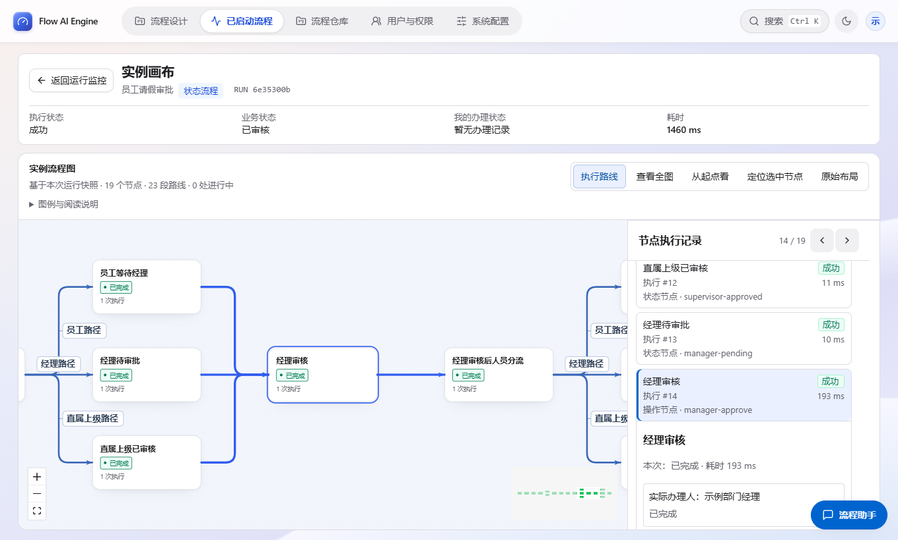
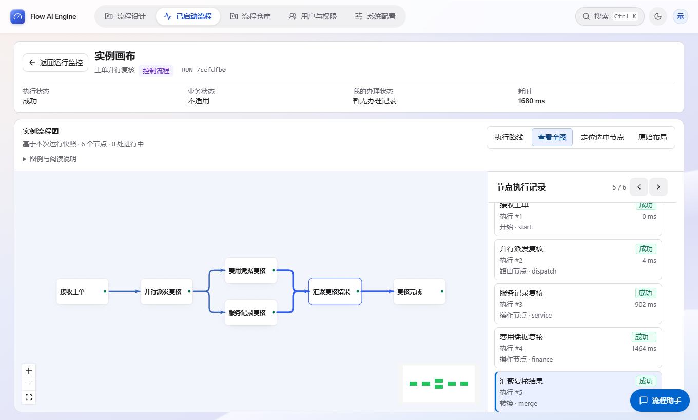
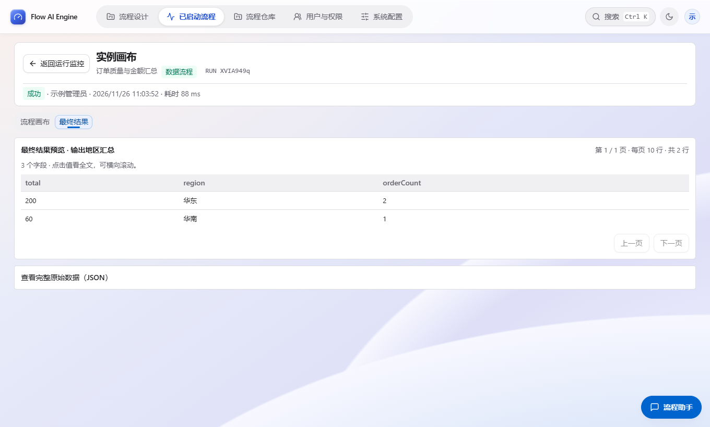

# 三类流程使用说明

从顶部「流程设计」进入业务中心，找到目标业务并点「进入」。在「流程设计中心」创建草稿、连接节点、配置运行参数，再保存、审核并发布。正式发起时会固定当时的定义和输入，返回运行编号。[控制台界面导览](../README.md#控制台界面)

办理分派给自己的任务时，打开「已启动流程」中的「流程工作台」。追踪某次运行时，切到「运行监控」，打开对应实例。状态和控制实例可按执行记录定位节点，数据实例可在「最终结果」查看输出。

## 状态流程

用于请假、事项办理等随人员和业务状态推进的场景。状态节点记录当前状态，操作节点确定谁能办理、可填什么以及允许的业务结论，路由节点据此选择下一段。员工请假示例按组织关系补充直属上级和部门经理，由两位审批人依次办理。

在按参与人建模的状态流程中，每个人有自己的状态卡和可执行操作。提交可让提交人进入「已提交」并给接收人生成「待处理」。撤回使原处理人的任务失效。重新选择接收人生成下一轮待办，重复提交同一已办命令可核对原回执。[参与人状态设计](participant-state-routing-design.md)

打开员工请假实例后，在右侧「节点执行记录」选中「经理审核」。画布会定位到该节点，记录下方显示办理结果。用面板顶部的左右箭头可按实际执行顺序逐条查看。

## 控制流程

适合编排条件、并行、人工复核、等待及外部调用。通常依据上一步输出决定后继节点。条件与普通路由在自己的分支规则下选择出口。并行路由可同时派发多条分支，须配置汇聚节点，进入汇聚前各分支先达到要求的终态。等待和消息节点保留挂起位置，符合条件后继续。循环返回边有次数上限，里程碑记录运行中已达成的阶段。

工单示例同时创建服务和费用两条复核待办。一条先完成时，另一条仍可办理。两条完成后，汇聚和出口各执行一次。具备运行控制权限时，可以暂停、恢复或取消实例。取消后未完成待办不再允许办理。[编译与执行设计](development/architecture.md)

在工单实例中切到「查看全图」，可以看到费用和服务两条分支如何汇聚。切回「执行路线」可按本次运行的节点记录追踪办理过程。

## 数据流程

数据流程按依赖图处理行集。资源节点读取项目资产，筛选、映射、关联、聚合等节点逐步生成结果。质量门检查行数和空值等条件，失败时保留失败节点的诊断。内联、MySQL 只读、固定版本 API 和 CSV 各有独立能力。写回外部系统须走连接器的预览、确认和回执核对。[连接器说明](development/optimization/G01-IMPLEMENTATION.md)

订单示例先排除取消的订单，经过质量校验后按地区汇总。打开运行实例的「最终结果」，按 `region`、`orderCount` 和 `total` 核对地区、订单数与金额。四条合成输入得到华东 2 单、200 元与华南 1 单、60 元。

## 内置节点速查

| 类型 | 节点集合与边界 |
| --- | --- |
| 状态、控制共用 | 开始、结束、操作、路由、REST、方法、表单、等待、消息等待、转换、条件、HTTP、LLM、子流程。 |
| 状态流程专有 | 状态节点，用于记录业务状态或参与人状态。 |
| 控制流程专有 | 里程碑，用于记录运行阶段。并行派发和汇聚分别通过路由与汇聚配置实现。 |
| 数据流程 | 开始、结束、资源、中间表、两类 SQL 节点、转换、筛选、字段映射、投影、派生、关联、合并、聚合、排序、去重、质量门、函数、两类输出节点。 |

节点表单、连接能力与校验来自共享契约。能否放置一个节点，还取决于当前流程类型。能否正式运行，还取决于配置、授权、发布快照和依赖可用性。[流程类型契约](../shared/flow-profile-contract.ts) · [节点参数契约](../shared/workflow-node-contract.ts)

## 人员、权限和运行管理

| 工作入口 | 常用任务 |
| --- | --- |
| 用户与权限 | 在账号目录创建或停用账号，在「组织架构」管理部门、直属关系、主部门和成员。系统角色、部门继承、项目授权及流程角色分别生效。授权到期或撤销后，系统按当前有效权限重新判断。 |
| 流程设计、流程仓库 | 编辑业务项目中的草稿，核对版本、审核发布、导入导出。恢复旧草稿或发布版本时重新核对权限和当前发布规则。 |
| 已启动流程 | 在工作台办理已分派任务，在运行监控核对运行记录、历史快照、节点日志和业务结果。可用的控制操作取决于角色和当前实例状态。 |
| 业务内的「资源配置中心」 | 管理资源并测试连接。在「数据流」中查看运行记录、产物血缘和调度，按运行编号核对进度与最终结果。 |
| AI 助手 | 管理员维护发布版和试聊。用户在已授权的业务上下文对话，先核对写入提案再确认。会话历史、后台回合与业务回执可分别查阅。 |

[开发索引](development/INDEX.md) · [完整需求与验收场景](development/optimization/ACCEPTANCE.md)
